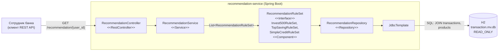
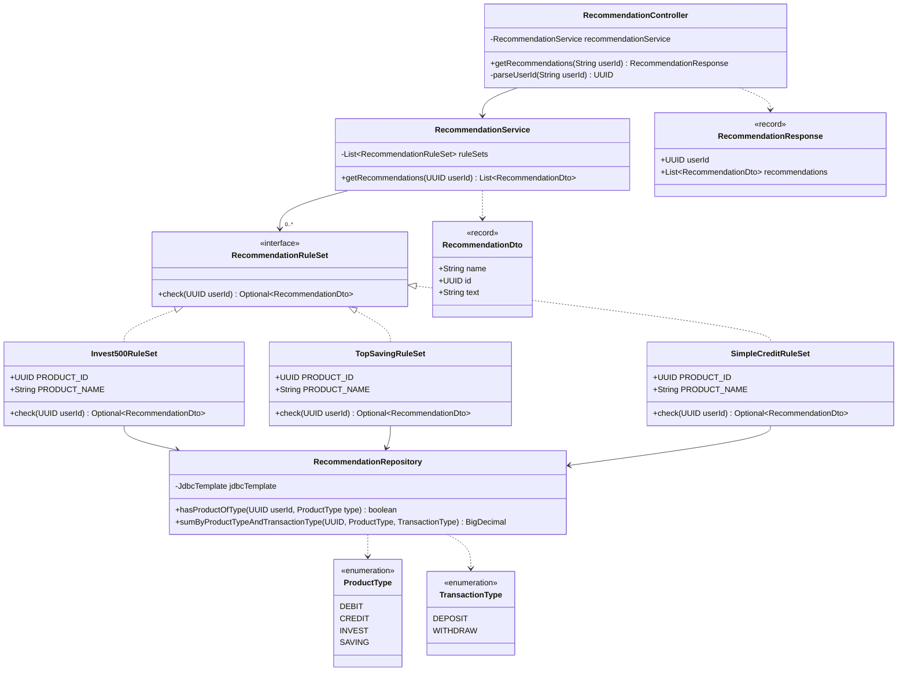
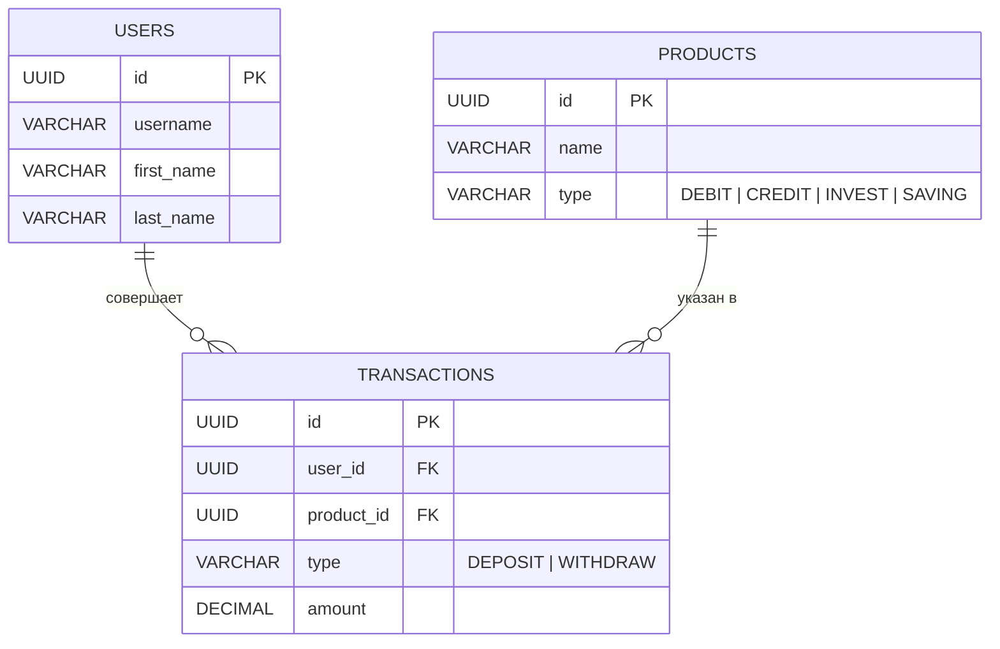

# Архитектура

## 1. Диаграмма компонентов



Компоненты и их ответственность:

| Компонент | Ответственность |
|---|---|
| `RecommendationController` | Приём HTTP-запроса, разбор `user_id`, формирование тела ответа |
| `RecommendationService` | Опрос всех наборов правил, сбор непустых результатов |
| `RecommendationRuleSet` | Контракт набора правил одной рекомендации |
| `Invest500RuleSet`, `TopSavingRuleSet`, `SimpleCreditRuleSet` | Проверка правил конкретного продукта |
| `RecommendationRepository` | Единственное место с SQL, доступ через `JdbcTemplate` |
| `RecommendationDto`, `RecommendationResponse` | Транспортные объекты уровня API |

## 2. Диаграмма классов



## 3. Схема данных (выданная БД)



Приложение читает эти таблицы и никогда их не изменяет.

## 4. Выделение общих SQL-запросов

Все правила трёх продуктов сводятся к двум вопросам:

1. Пользуется ли клиент продуктом типа `T`? → `HAS_PRODUCT_OF_TYPE`
   (`JOIN transactions/products`, `WHERE user_id = ? AND p.type = ?`, `COUNT(*) > 0`).
2. Какова сумма операций вида `X` по продуктам типа `T`? → `SUM_BY_PRODUCT_TYPE_AND_TRANSACTION_TYPE`
   (`JOIN transactions/products`, `WHERE user_id = ? AND p.type = ? AND t.type = ?`, `SUM(t.amount)`).

Оба запроса параметризованы и переиспользуются всеми правилами:

| Правило | Обращения к репозиторию |
|---|---|
| Invest 500 | `hasProductOfType(DEBIT)`, `hasProductOfType(INVEST)`, `sum(SAVING, DEPOSIT)` |
| Top Saving | `hasProductOfType(DEBIT)`, `sum(DEBIT, DEPOSIT)`, `sum(SAVING, DEPOSIT)`, `sum(DEBIT, WITHDRAW)` |
| Простой кредит | `hasProductOfType(CREDIT)`, `sum(DEBIT, DEPOSIT)`, `sum(DEBIT, WITHDRAW)` |

Сравнение с порогами (`> 1000`, `>= 50 000`, `> 100 000`) и логические связки выполняются
в Java: SQL остаётся простым и читаемым, а логика правил покрывается модульными тестами без БД.

## 5. Расширение

Новый продукт добавляется одним классом:

```java
@Component
public class NewProductRuleSet implements RecommendationRuleSet {
    @Override
    public Optional<RecommendationDto> check(UUID userId) { ... }
}
```

`RecommendationService` подхватывает его автоматически через `List<RecommendationRuleSet>`.
Изменения в контроллере, сервисе и существующих правилах не требуются.
