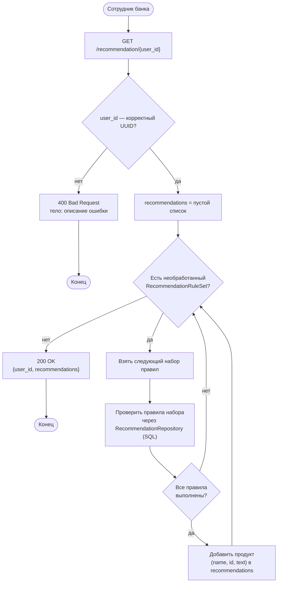
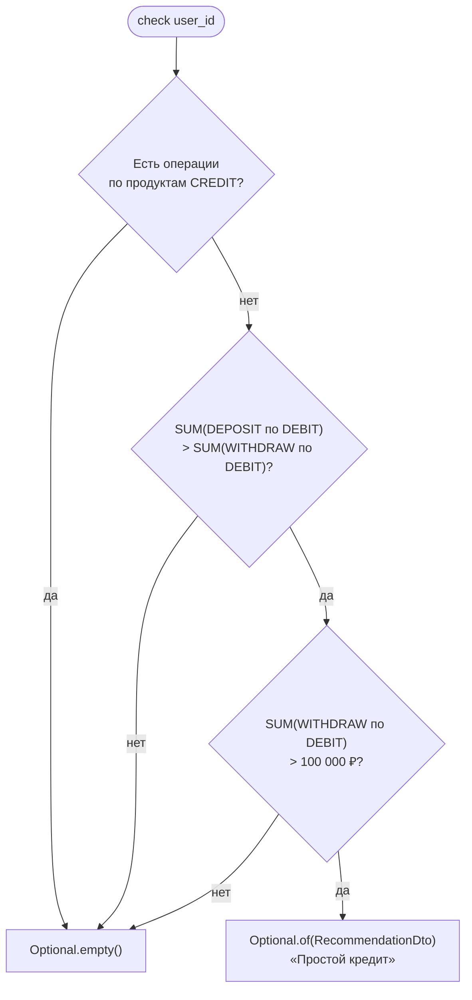
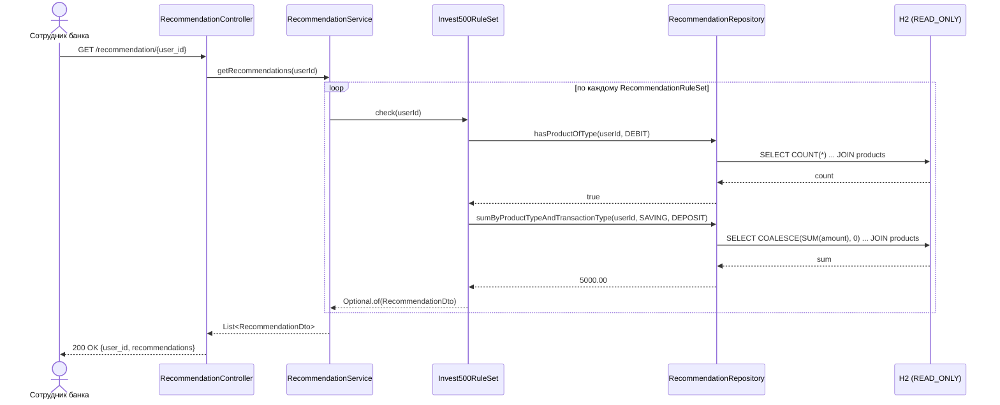

# Диаграмма поведения (Activity Diagram)

Сценарий: получение рекомендаций для клиента.

## Проверка правил одного набора

На примере «Простой кредит» (`SimpleCreditRuleSet.check`):

Аналогично устроены `Invest500RuleSet` (`DEBIT есть` И `INVEST нет` И `SUM(SAVING, DEPOSIT) > 1000`)
и `TopSavingRuleSet` (`DEBIT есть` И (`SUM(DEBIT, DEPOSIT) >= 50 000` ИЛИ `SUM(SAVING, DEPOSIT) >= 50 000`)
И `SUM(DEBIT, DEPOSIT) > SUM(DEBIT, WITHDRAW)`).

## Последовательность вызовов

