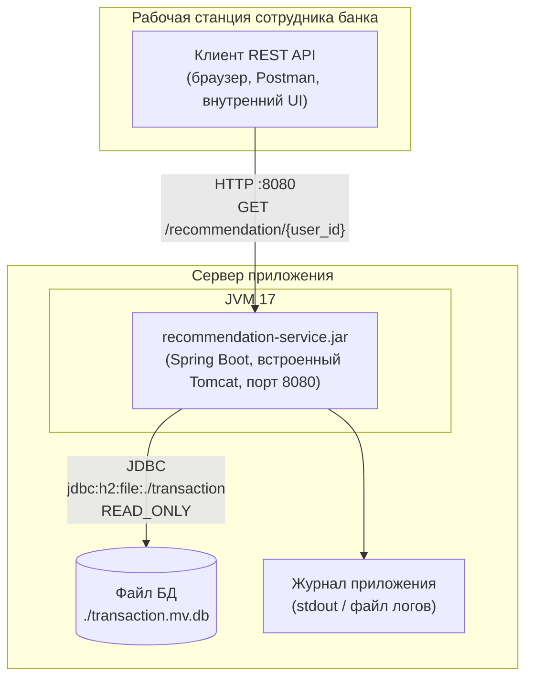

# Требования по развёртыванию

## 1. Диаграмма размещения



## 2. Требования к окружению

| Параметр | Значение |
|---|---|
| ОС | Windows Server 2019+, Linux x86_64 (приложение платформенно-независимо) |
| Java | JDK/JRE 17 или новее (`java -version`) |
| Память | от 512 МБ для JVM; фактическое потребление MVP — около 250 МБ |
| Диск | около 100 МБ под артефакт и логи + размер файла БД |
| Сеть | входящий TCP-порт приложения (по умолчанию 8080) |
| Внешние зависимости | отсутствуют (БД встроенная, файловая) |
| Доступ к БД | файл `transaction.mv.db` доступен на чтение процессу приложения |

## 3. Артефакты развёртывания

| Артефакт | Назначение |
|---|---|
| `recommendation-service-0.1.0-SNAPSHOT.jar` | исполняемый Spring Boot jar (`mvn clean package`) |
| `transaction.mv.db` | база данных, выданная банком; в репозиторий не коммитится |
| `application.properties` | при необходимости переопределяется внешним файлом рядом с jar |

## 4. Порядок развёртывания

```bash
# 1. Сборка
mvn clean package

# 2. Размещение артефактов в одном каталоге
#    /opt/star-recommendation/
#      recommendation-service-0.1.0-SNAPSHOT.jar
#      transaction.mv.db
#      application.properties (опционально)

# 3. Запуск
java -jar recommendation-service-0.1.0-SNAPSHOT.jar

# 4. Проверка
curl -i http://localhost:8080/recommendation/cd515076-5d8a-44be-930e-8d4fcb79f42d
```

Приложение читает `transaction.mv.db` относительно рабочего каталога запуска (`./transaction`),
поэтому файл БД должен лежать рядом с местом запуска либо путь задаётся параметром:

```bash
java -jar recommendation-service-0.1.0-SNAPSHOT.jar \
  --spring.datasource.url=jdbc:h2:file:/opt/star-recommendation/transaction
```

## 5. Конфигурация

| Свойство | Значение по умолчанию | Назначение |
|---|---|---|
| `spring.datasource.url` | `jdbc:h2:file:./transaction` | Путь к выданной БД |
| `spring.datasource.driver-class-name` | `org.h2.Driver` | Драйвер H2 |
| `spring.datasource.username` / `password` | `sa` / пусто | Учётные данные файловой БД |
| `spring.datasource.hikari.read-only` | `true` | Соединения только для чтения |
| `server.port` | `8080` | Порт HTTP |

Секретов в конфигурации нет: БД локальная и доступна только процессу приложения.

## 6. Эксплуатация

- **Мониторинг.** Проверка живости — любой вызов `GET /recommendation/{существующий_user_id}`;
  ожидается `200 OK`. Время ответа на MVP-объёме данных — единицы миллисекунд.
- **Логи.** Пишутся в stdout; при развёртывании перенаправляются в файл или journal системы.
- **Обновление.** Остановить процесс, заменить jar, запустить заново. Состояния приложение не хранит,
  миграции не выполняются, поэтому откат — возврат предыдущего jar.
- **Резервное копирование.** Выполняется только для файла БД силами банка: приложение данные не изменяет.
- **Масштабирование.** Сервис без состояния, допускается запуск нескольких экземпляров за балансировщиком;
  файл H2 в этом случае должен быть заменён на сетевую СУБД (изменение только в `application.properties`).
